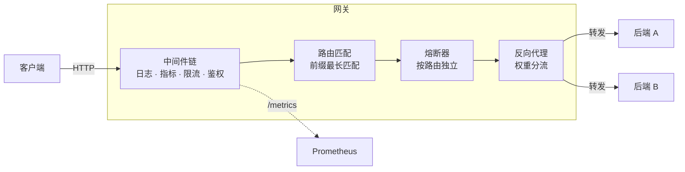
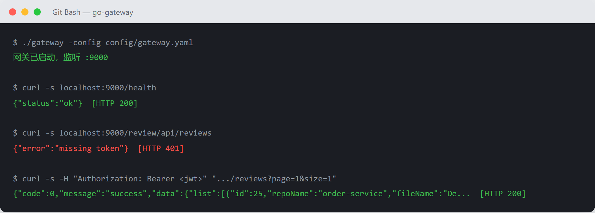
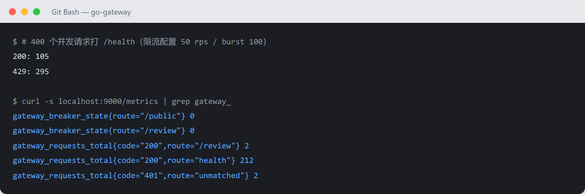

# go-gateway

用 Go 写的 HTTP 网关：路由转发、JWT 鉴权、令牌桶限流、熔断、Prometheus 指标、配置热加载。

不是玩具 demo——限流按客户端独立记账，熔断分三态，配置改错不会把网关搞挂。

## 解决什么问题

后端服务多了以后，鉴权、限流、日志、指标这些事不该在每个服务里重复实现一遍。网关统一收口：请求先进网关，做完这些横切逻辑再转发给后端。

```
客户端 --> 网关 --> 后端服务
             |
        限流 / 鉴权 / 熔断 / 日志 / 指标
```

## 架构



中间件顺序是有讲究的：日志在最外层，保证被限流拒绝的请求也能记下来；指标在限流之后，统计的才是真实放行的流量。

## 功能与实现

### 限流

每个客户端 IP 一个独立令牌桶（`golang.org/x/time/rate`），后台每分钟清理 3 分钟不活跃的条目，否则 map 会随着扫端口的爬虫无限增长。

超限直接返回 429 加 `Retry-After`，不进入代理逻辑。

### 熔断

按路由独立的三态熔断器：

| 状态 | 行为 |
|---|---|
| 关闭 | 正常放行，累计失败次数 |
| 打开 | 直接返回 503，不再打后端 |
| 半开 | 到期后只放一个请求探测，成功则关闭，失败则重新打开 |

半开只放一个请求，是为了避免后端刚恢复就被积压流量打垮。

失败判定看响应状态码：5xx 计失败，其余计成功。

### 鉴权

JWT 校验只接受 HMAC 系列算法，显式拒绝 `alg=none`——这是最常见的 JWT 降级攻击。校验通过后把 `sub` 写进 `X-User` 头传给后端。

白名单路径（`/health`、`/metrics`、`/public/`）跳过校验。

### 配置热加载

每 2 秒检查配置文件修改时间，变了就重新解析。**解析或校验失败时保留旧配置**，不会因为改错一个字符导致网关挂掉。鉴权参数和限流参数可以热更新，路由表变更需要重启。

### 可观测

| 指标 | 类型 | 说明 |
|---|---|---|
| `gateway_requests_total` | Counter | 按路由与状态码 |
| `gateway_request_duration_seconds` | Histogram | 请求耗时分布 |
| `gateway_breaker_state` | Gauge | 0 关闭 / 1 半开 / 2 打开 |

`/metrics` 不经过限流，否则 Prometheus 抓取会被自己限掉。

## 快速开始

```bash
go mod tidy
go build -o gateway ./cmd/gateway
./gateway -config config/gateway.yaml
```

配置文件里 `routes` 指定前缀和上游地址，示例配置把 `/review` 转发到本地的 `127.0.0.1:8090`。

验证：

```bash
curl localhost:9000/health
curl localhost:9000/metrics | grep gateway_
curl localhost:9000/review/api/reviews          # 无 token 返回 401
```

## 运行效果

以下两图是命令的实际输出（终端渲染）：



启动后健康检查返回 200；访问受保护路由不带 token 返回 401，带上 JWT 后转发到后端并返回数据。



400 个并发请求中 105 个通过、295 个被限流拒绝；指标里能看到按路由和状态码聚合的计数。

## 实测数据

400 个并发请求打 `/health`（限流配置 50 rps、burst 100）：

```
200: 106
429: 294
```

后端停掉后连续请求，第 5 次后熔断打开：

```
第 1 次: 502      第 5 次: 502
第 2 次: 502      第 6 次: 503   <- 熔断打开
第 3 次: 502      第 7 次: 503
第 4 次: 502      第 8 次: 503
```

## 已知限制

- 只有前缀匹配，不支持正则路由与路径参数
- 限流维度只有客户端 IP，没有按用户或 API Key
- 熔断是进程内的，多实例部署时各算各的（生产环境通常接入 Sentinel 或做集中式统计）
- 没有 TLS 终止，需要前置 Nginx
